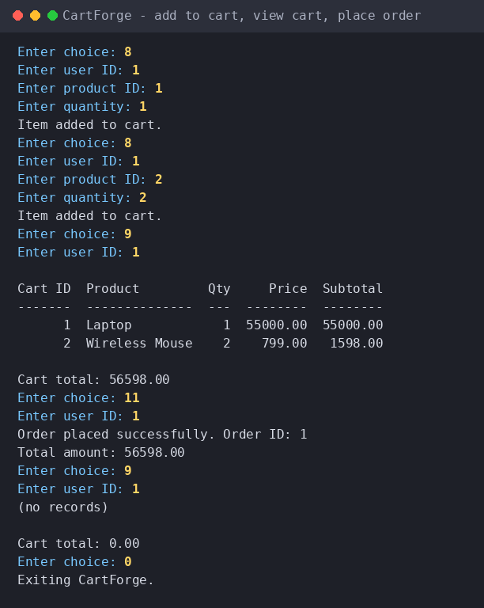
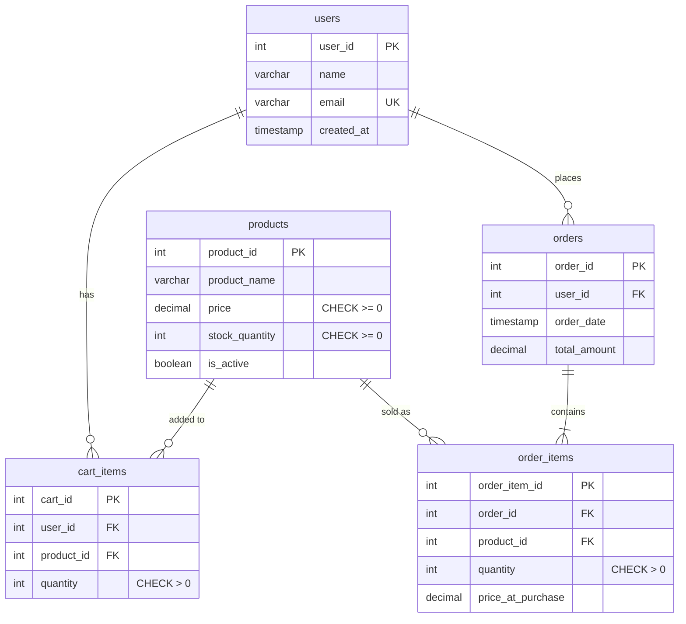
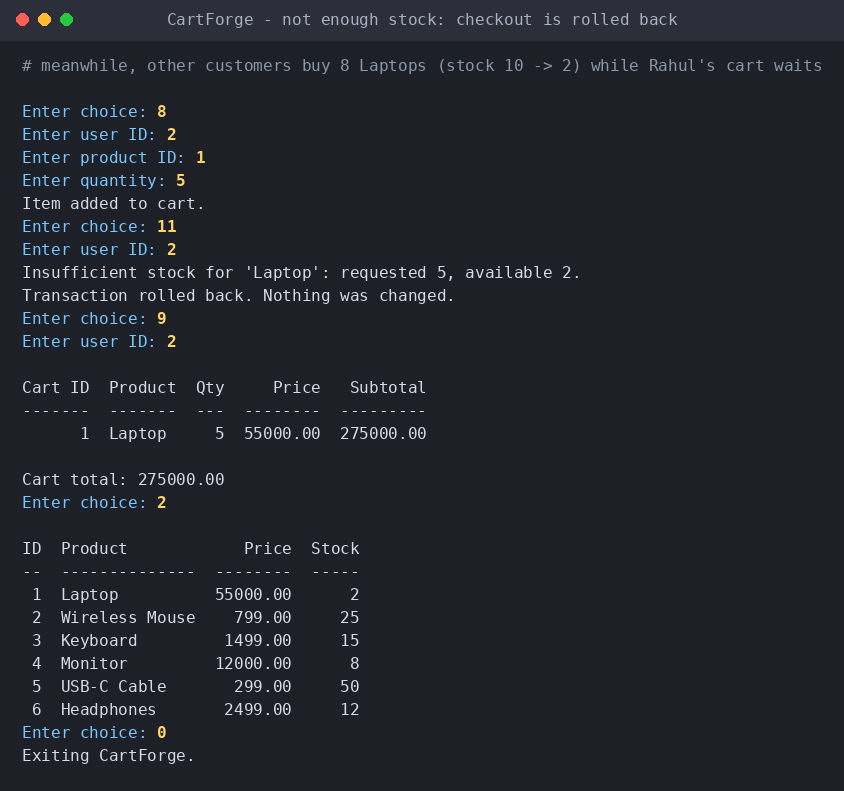

# CartForge – E-Commerce Inventory & Order Management System

CartForge is a console-based e-commerce backend written in **C++17** on top of **MySQL 8.0**.
It manages products, users, shopping carts, orders, inventory and sales reports, and keeps
inventory consistent with a **transaction-safe, row-locked checkout**.

It demonstrates:

* Object-Oriented Programming (one class per domain: `Product`, `User`, `Cart`, `OrderManager`)
* Relational design, constraints, foreign keys and indexes
* SQL joins, aggregates, `GROUP BY` / `HAVING`, window functions
* Transactions, `COMMIT` / `ROLLBACK`, ACID, row-level locking
* Safe database access with **prepared statements** (no SQL injection)
* Automated tests, including a real concurrency test



---

## Tech stack

* C++17 (g++)
* MySQL Server 8.0 + MySQL C client library (`mysql.h`)
* MySQL Workbench (optional, for browsing the data)
* Make, Git, GitHub, VS Code

---

## Features

**Products** – add, view, search (wildcard-safe), update stock, delete  
**Users** – add (e-mail validated, duplicates rejected), view  
**Cart** – add (stock-checked), view with subtotals and total, remove  
**Orders** – transactional checkout, stock validation, price snapshot, cart cleanup, history  
**Reports** – low stock, total sales, top-selling products (units and revenue), per-user lifetime spend

Deleting a product that was ever ordered **archives** it (`is_active = 0`) instead of deleting it,
so order history and sales reports are never damaged.

---

## Getting started

### 1. Create the database

```bash
mysql -u root -p < database/schema.sql
mysql -u root -p < database/sample_data.sql
```

`schema.sql` **drops and recreates** the `cartforge` database.

### 2. Build

**Linux / macOS / MSYS2**

```bash
# Ubuntu/Debian:  sudo apt install g++ make libmysqlclient-dev
# macOS (Homebrew): brew install mysql-client   (and add it to your PATH)
make
```

**Windows (MinGW-w64 g++)** – adjust the path to your MySQL install:

```powershell
g++ -std=c++17 src/*.cpp -o cartforge.exe `
    -I"C:/Program Files/MySQL/MySQL Server 8.0/include" `
    "C:/Program Files/MySQL/MySQL Server 8.0/lib/libmysql.dll"
```

Copy `libmysql.dll` next to `cartforge.exe`. *(The Linux build is what the automated tests ran on;
the Windows command is the standard approach but has not been run by the author of this README.)*

### 3. Configure the connection

By default the program connects to `127.0.0.1:3306` as `root` with an **empty password**.
If your MySQL differs, set environment variables – no code changes needed:

| Variable | Default |
|---|---|
| `CARTFORGE_DB_HOST` | `127.0.0.1` |
| `CARTFORGE_DB_PORT` | `3306` |
| `CARTFORGE_DB_USER` | `root` |
| `CARTFORGE_DB_PASSWORD` | *(empty)* |
| `CARTFORGE_DB_NAME` | `cartforge` |

```bash
export CARTFORGE_DB_PASSWORD='your-password'        # Linux / macOS
$env:CARTFORGE_DB_PASSWORD = "your-password"        # Windows PowerShell
```

### 4. Run

```bash
./cartforge          # or .\cartforge.exe on Windows
```

---

## Database schema



| Table | Purpose |
|---|---|
| `users` | Customers |
| `products` | Catalogue and inventory (`is_active = 0` means archived) |
| `cart_items` | Current cart; `UNIQUE (user_id, product_id)` so re-adding increases the quantity |
| `orders` | One row per placed order |
| `order_items` | Line items; `price_at_purchase` is a deliberate **price snapshot** |

### Relationships

* **User → Orders** – one-to-many
* **Order → Order Items** – one-to-many
* **Users ↔ Products** – many-to-many through `cart_items`
* **Orders ↔ Products** – many-to-many through `order_items`

### Delete rules (deliberate)

| Relationship | Rule | Why |
|---|---|---|
| `cart_items` → users / products | `CASCADE` | Carts are disposable |
| `order_items` → orders | `CASCADE` | A line item has no meaning without its order |
| `order_items` → products | `RESTRICT` | A product that was ever sold can't be erased from history |
| `orders` → users | `RESTRICT` | A customer with orders can't be erased |

---

## Transaction-safe order placement

`OrderManager::placeOrder()` runs the whole checkout as one transaction:

1. `START TRANSACTION`
2. Lock the user's cart rows – `SELECT … FOR UPDATE`
3. Lock each product row, **lowest `product_id` first** – `SELECT … FOR UPDATE`
4. Validate every line against the *locked* stock
5. Insert the `orders` row and the `order_items` (price snapshot)
6. Deduct inventory
7. Compute the order total in SQL (exact `DECIMAL` maths, no floating point)
8. Clear the user's cart
9. `COMMIT` – if **any** step fails: `ROLLBACK` and nothing changes

If MySQL ever picks the transaction as a deadlock victim, the checkout is retried (up to 3 times).

### Why transactions?

Without one, a failure halfway (order saved, stock update failed) leaves the database in an
invalid state. With one, either every change is applied or none is.

### Concurrency: two users buy the last item at the same time

The first transaction locks the product row. The second **waits** on that lock, then sees the
reduced stock and is rejected – overselling is impossible. Locking products in a fixed order
means two checkouts with overlapping products queue up instead of deadlocking. The
`CHECK (stock_quantity >= 0)` constraint is a second safety net.



---

## Tests

Both scripts drive the **real program** against a real MySQL server and check the resulting
database state. They reload `schema.sql`, so they **drop the `cartforge` database** – run them
on a development server only.

```bash
make
export CARTFORGE_DB_USER=root CARTFORGE_DB_PASSWORD=your-password   # as needed

./tests/smoke_test.sh          # 28 checks: cart, checkout, rollback, SQL injection, archive, input handling
./tests/concurrency_test.sh    # two buyers, last item
```

The concurrency test has two parts: (A) two app processes check out the last item simultaneously,
25 rounds, exactly one may succeed every time; (B) a SQL session holds the row lock for 3 seconds
and the app's checkout must visibly wait and then be rejected. Removing `FOR UPDATE` from the code
makes this test fail, so it genuinely exercises the locking.

Requires the `mysql` command-line client on your `PATH`.

---

## SQL tour

[`database/queries.sql`](database/queries.sql) collects the SQL behind the app: catalogue and cart
queries, multi-table joins, `GROUP BY` / `HAVING`, a `RANK()` window function, anti-joins, a
"bought together" self-join, integrity checks that must return zero rows, the full checkout
transaction written as plain SQL, and a two-session locking demo. Sections 1–6 are read-only, so
the whole file can be run safely.

---

## DBMS concepts demonstrated

Primary keys · Foreign keys · Constraints (`CHECK`, `UNIQUE`, `NOT NULL`) · Indexing · Normalization ·
Joins · Aggregate functions · Window functions · Transactions · Commit / Rollback · ACID ·
Row-level locking · Deadlock avoidance (ordered locking + retry) · Prepared statements

---

## Project structure

```text
CartForge/
├── README.md
├── Makefile
├── .gitignore
├── database/
│   ├── schema.sql          tables, constraints, indexes
│   ├── sample_data.sql     3 users, 6 products
│   └── queries.sql         joins, reports, integrity checks, transaction demos
├── src/
│   ├── main.cpp            menu loop
│   ├── db_connection.*     connection config + prepared-statement wrapper
│   ├── utils.*             validated input + table printing
│   ├── product.*           product management
│   ├── user.*              user management
│   ├── cart.*              cart operations
│   └── order.*             checkout, order history, reports
├── tests/
│   ├── smoke_test.sh
│   └── concurrency_test.sh
├── docs/
│   └── sample_session.txt  captured output of real sessions
└── screenshots/            images of the running program
```

---

## Known limitations

* No authentication – anyone using the console can act as any user ID (see *Future improvements*).
* Prices are a single currency with no tax, shipping or discounts.
* Orders cannot be cancelled or refunded yet.
* Console input is line-based; there is no GUI or web front end.

## Future improvements

* REST API layer
* Authentication and roles
* Admin dashboard
* Order cancellation and refunds (restock in a transaction)
* Payment simulation
* Docker Compose (app + MySQL) deployment
* Unit tests with a C++ test framework
